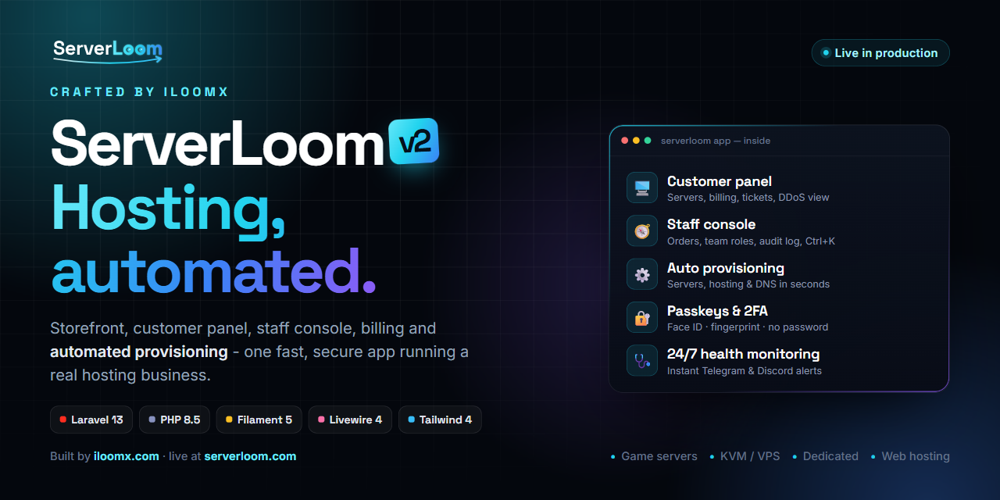
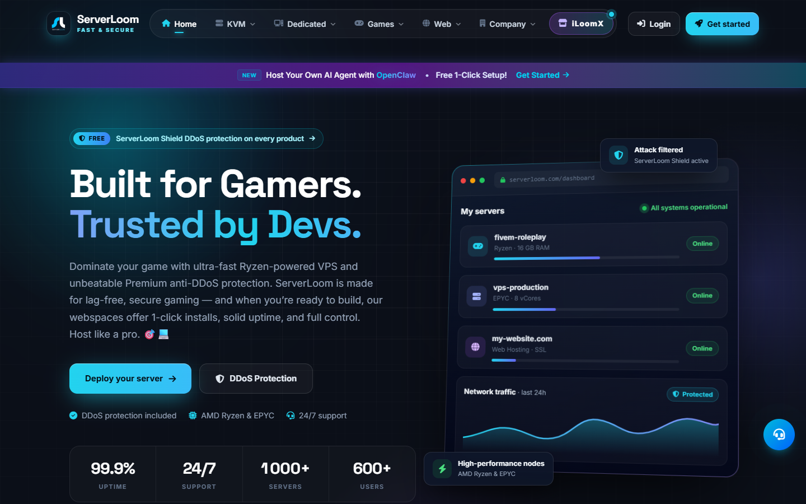
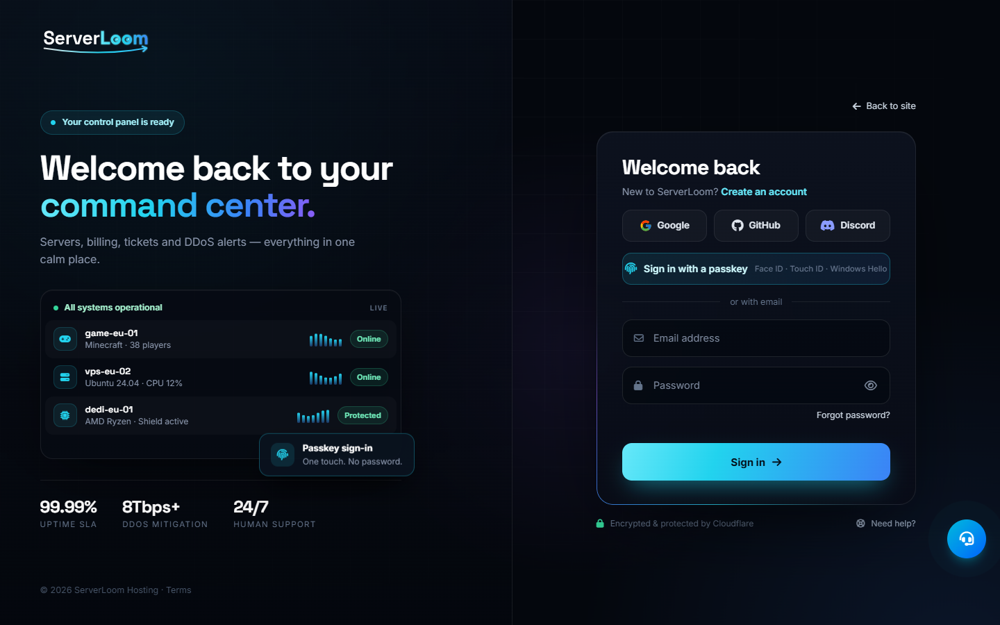
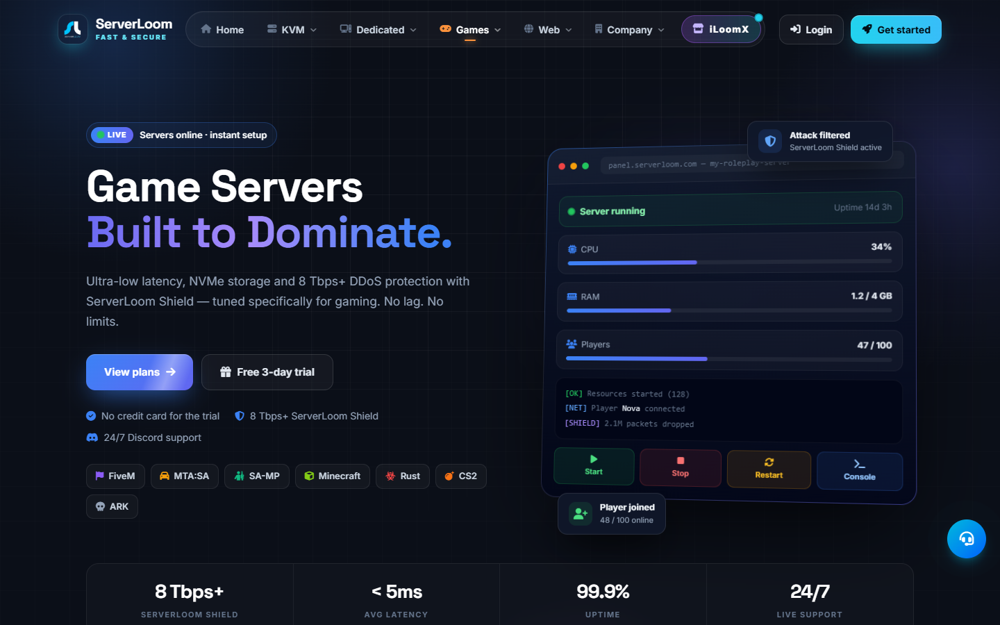
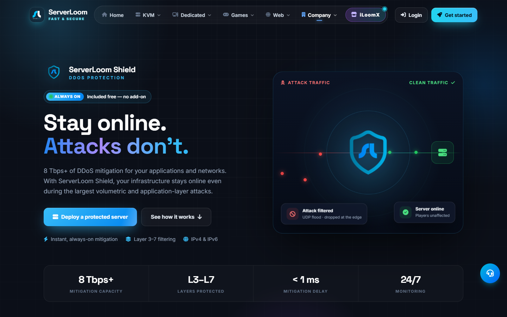
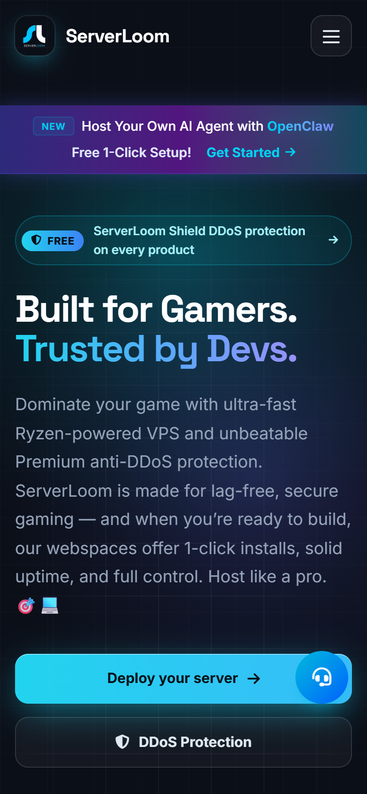
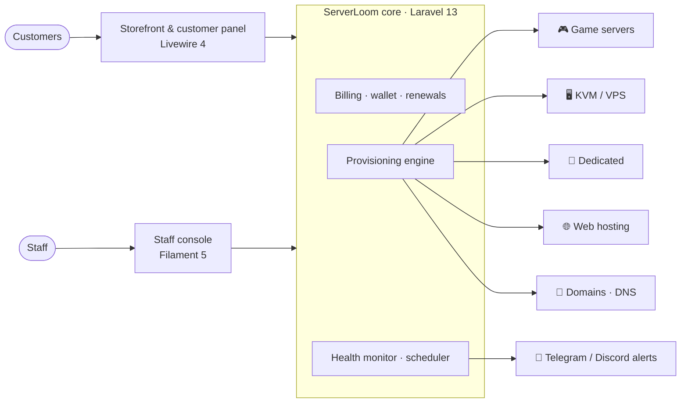

 

### The all-in-one platform that runs a real hosting business.

Storefront, customer panel, staff console, billing and automated provisioning in **one fast, secure app**. 
Designed and engineered by **[iLoomX](https://iloomx.com)**. Live today at **[serverloom.com](https://serverloom.com)**.

**[🌐 See it live](https://serverloom.com)** · **[🚀 Get a platform like this](https://iloomx.com)** · **[📜 Changelog](CHANGELOG.md)** · **[🗺️ Roadmap](#%EF%B8%8F-roadmap)**

---

## 📸 A look inside

<table>
<tr>
<td width="50%">
<b>Storefront</b>: fast, animated, and built for phones first
</td>
<td width="50%">
<b>Sign-in</b>: passkeys, Google, GitHub and Discord
</td>
</tr>
<tr>
<td width="50%">
<b>Game servers</b>: free trial and instant setup
</td>
<td width="50%">
<b>ServerLoom Shield</b>: always-on DDoS protection
</td>
</tr>
</table>

<b>📱 Mobile view</b>

 

---

## 🧩 What it sells, fully automated

| | Product line | Highlights |
|:-:|---|---|
| 🎮 | **Game servers** | FiveM · MTA:SA · SA-MP · Minecraft · Rust · CS2 · ARK, with a free trial and instant setup |
| 🖥️ | **KVM / VPS** | AMD Ryzen and EPYC lines plus an economy range; power, console, reinstall and rDNS from the panel |
| 🏢 | **Dedicated servers** | Intel, AMD, premium and clearance lines, with full remote management |
| 🌐 | **Web hosting** | cPanel accounts created in seconds, a free subdomain with automatic DNS, and one-click panel access |
| ☁️ | **Nextcloud** | Private cloud storage, configured at checkout |
| 🤖 | **Discord bots** | Bot hosting with guided configuration |
| 🧠 | **AI agents** | One-click hosting for your own AI agent (OpenClaw) |
| 🔗 | **Domains** | Registration, DNS and reverse DNS across several branded domains |
| 🛡️ | **ServerLoom Shield** | DDoS protection on every product, with attack alerts in the panel |

---

## ✨ Features

<table>
<tr>
<td width="50%" valign="top">

### 👤 Customer panel
- One dashboard for every service, with live status
- Server control: start / stop / restart, console, reinstall, rDNS
- DDoS view with attack history and alerts
- Invoices, **wallet** top-ups and auto-renewals
- Support tickets and a **ServerLoom AI** assistant
- Affiliate program with referral links
- API keys for automation
- Tutorials library and a digital store

</td>
<td width="50%" valign="top">

### 🧭 Staff console
- Orders, services, customers and renewals in one place
- **Team roles & permissions** for every operator
- **Activity log**: who changed what, and when
- **Notification centre**, plus messages to customers
- **Ctrl+K spotlight** search and saved table views
- Provider settings managed in the UI, stored encrypted
- Backups, log viewer and visitor analytics
- Branded emails for every message

</td>
</tr>
<tr>
<td valign="top">

### 🔐 Security
- **Passkeys** (Face ID / Touch ID / Windows Hello) for customers *and* staff
- Two-factor authentication and social login
- Bot protection on every public form
- Hardened payment paths and tamper-proof panel state
- Credentials encrypted at rest; strict security headers
- Edge protection by Cloudflare

</td>
<td valign="top">

### ⚙️ Automation & reliability
- Automated provisioning for servers, hosting and DNS
- Renewals, suspensions and reminders on autopilot
- **System health** page watching every scheduled task
- Instant **Telegram / Discord** alerts when something fails
- Unused integrations switched off with one click
- 80+ automated smoke tests on every release

</td>
</tr>
<tr>
<td valign="top">

### 💳 Billing
- Card payments (Stripe) and PayPal
- Built-in wallet with full transaction history
- Vouchers, discounts and promotions
- Clear invoices and order history

</td>
<td valign="top">

### ⚡ Performance
- Self-hosted fonts and a trimmed icon set (**302 KB → 32 KB**)
- No render-blocking third parties
- Light, reactive pages with Livewire 4
- Designed for phones first, polished on desktop

</td>
</tr>
</table>

---

## 🧱 Built with

| Layer | Technology |
|---|---|
| Core | **Laravel 13** on **PHP 8.5** |
| Staff console | **Filament 5** with a custom ServerLoom theme |
| Customer panel & storefront | **Livewire 4** · Alpine.js · **Tailwind CSS 4** · Vite |
| Data | **MySQL 8** |
| Payments | Stripe · PayPal · internal wallet |
| Messaging | Branded email · Telegram · Discord |
| Edge | Cloudflare (DNS, protection, bot checks) |

| **28** | **67** | **115** | **80+** | **1** |
|:-:|:-:|:-:|:-:|:-:|
| admin resources | Livewire components | database migrations | smoke tests | app running it all |

### How it fits together

---

## 🗺️ Roadmap

| Status | Item |
|:-:|---|
| ✅ | **v2.0**: full rebuild on Laravel 13 / Filament 5 / Livewire 4 |
| ✅ | Passkeys, health monitoring, activity log, notification centre |
| ✅ | Multiple rDNS domains and provider management in the UI |
| 🔜 | **Multi-language panel**: English, Italiano, Français, Deutsch, العربية |
| 🔜 | **Reseller accounts**: sell under your own brand with your own team |
| 🔜 | More dedicated server locations |
| 💡 | Public status page with uptime history |
| 💡 | Mobile app for server control on the go |

✅ shipped · 🔜 in progress · 💡 exploring

---

## 🏗️ Crafted by iLoomX

<table>
<tr>
<td>

**[iLoomX](https://iloomx.com)** is the studio behind ServerLoom: design, engineering, launch and ongoing support.

We build **custom platforms, web apps and e-commerce** that are fast, secure and made to grow:

- 🎨 UI/UX design that feels premium on every screen
- ⚙️ Laravel / Livewire / Filament engineering
- 🛒 Billing, payments and automation
- 🚀 Deployment, monitoring and support after launch

**Need a hosting platform, a client portal or a custom web app like this one?**

</td>
</tr>
</table>

---

## ❓ FAQ

<b>Is the source code available?</b>

 
No. ServerLoom App is proprietary software that runs a live business. This repository is a public showcase of what it does.

<b>Can I get a platform like this for my company?</b>

 
Yes. iLoomX designs and builds custom platforms. Tell us what you need at <a href="https://iloomx.com">iloomx.com</a>.

<b>Where can I try it?</b>

 
Everything shown here is live at <a href="https://serverloom.com">serverloom.com</a>. Game servers include a free trial.

<b>I found a security issue. Who do I tell?</b>

 
Please report it privately. See <a href="SECURITY.md">SECURITY.md</a>.

---

**[serverloom.com](https://serverloom.com)** · **[iloomx.com](https://iloomx.com)**

© 2026 ServerLoom Hosting · Crafted by iLoomX · All rights reserved. Screenshots and brand assets may not be reused without permission.

